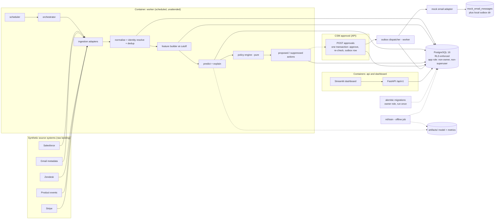

# Architecture

## Goals and constraints

- Runs locally with `docker compose up`, no cloud credentials.
- Application containers: `api` and `dashboard` (separate Compose services built from the same Dockerfile), and a worker (not containerised yet), plus PostgreSQL. The original plan ran Streamlit inside the API container under a process supervisor; Compose runs it as its own service instead.
- Deterministic processing. No LLM in any path.
- Tenant isolation enforced in the data model, in queries, and by PostgreSQL RLS.
- Training, inference, feature engineering, action policy, and delivery are separate modules with one-way dependencies.

## Component responsibilities

| Component | Responsibility | Does not do |
|---|---|---|
| `ingestion/generators` | Produce the canonical synthetic fixture (50 accounts, 1,000 records, seeded, with injected defects). Run only by `generate-fixtures`; never imported by the platform. | Touch features or predictions, or be read at runtime. |
| `ingestion/canonical.py` | Load the committed fixture for `seed`: verify checksums, create demo organisations, ingest per org. Idempotent. | Generate data. |
| `ingestion/adapters` | One adapter per source. Parses raw payloads into a common event shape. | Decide identity beyond the resolver. |
| `ingestion/normalization.py` | Canonicalise timestamps (UTC), currencies, domains, names. Map to canonical account via identity resolution. | Store predictions. |
| `ingestion/deduplication.py` | Content-hash based dedup and natural-key upserts. | Business logic. |
| `features/definitions.py` | Declarative feature specs: name, source, window, aggregation, and as-of rule. | Read the database directly. |
| `features/builder.py` | Compute feature matrices for `(org, account, cutoff)` using only events with `event_time <= cutoff` and `ingested_at <= cutoff`. | Train models. |
| `ml/train.py` | Build training set from historical cutoffs, fit candidates, select by pre-registered rule, persist artifact and metrics. | Write predictions for customers. |
| `ml/evaluate.py` | Temporal holdout metrics, calibration, slice metrics, baseline comparison. | Fit models. |
| `ml/predict.py` | Load a registered model version, score a feature snapshot, return probabilities. | Decide actions. |
| `ml/explain.py` | Per-prediction contributions (linear coefficients x value deltas from a reference, or tree-based contributions). | Generate prose with an LLM. |
| `agent/scheduler.py` | Cron-style trigger that enqueues one run per organisation. | Run jobs inline. |
| `agent/orchestrator.py` | Runs one organisation's pipeline stages in order, records stage status, and resumes safely. | Contain business rules. |
| `agent/policies.py` | Pure functions: given a score, signals, and history, decide whether an action is eligible, suppressed, or deduplicated. | Send anything. |
| `agent/actions.py` | Creates recommended actions (`proposed` or `suppressed`). Writes outbox rows only when a human approval is recorded, in the same transaction. | Call email providers. |
| `notifications/interface.py` | `EmailSender` protocol. | Implementation details. |
| `notifications/mock_email.py` | Captures messages to a table and a local outbox directory. Default and only adapter in this build. | Reach the internet. |
| `db/` | SQLAlchemy models, repositories (the only code that issues queries), session factory that sets tenant context. | Business rules. |
| `security/` | API key issuance and verification, tenant context resolution, RLS helpers. | Feature logic. |
| `api/` | FastAPI routes. Tenant comes from the authenticated principal only. Read-mostly. | Score or ingest. |
| `dashboard/` | Streamlit pages that are API clients only (ADR-012). Holds the user's API key, not a database connection. | Query the database, or compute metrics itself. Every displayed value comes from an API response backed by stored evaluation records and prediction snapshots. |
| `cli.py` | Commands: `generate-fixtures`, `seed`, `export-openapi`, `migrate`, `train`, `run-worker-once`, `create-org`, `issue-key`, `init-dev-tokens`. | Hidden side effects. |

### Dependency direction

```
api, dashboard, cli, agent  ->  features, ml, notifications, security  ->  db
ingestion                    ->  db
ml/train                     ->  features (never the reverse)
features                     ->  db (read-only repositories)
policies                     ->  nothing (pure)
```

`ml/` does not import `agent/`. `agent/policies.py` does not import `ml/` or `db/`; the orchestrator passes it plain values. This keeps policy logic unit-testable without a database.

## Architecture diagram



## Request and processing flows

### Scheduled run (per organisation)

1. The worker reads its configured organisation IDs (validated against `organizations` at startup) and creates one run per organisation in `pipeline_runs`, unique on `(org_id, cutoff_at)`.
2. The same process executes the runs one organisation at a time, setting `app.current_org_id` per transaction and recording each stage's start and finish. No claim policies or scheduler role (ADR-022).
3. Stages run in order: `ingest` -> `normalise` -> `features` -> `score` -> `policy` -> `enqueue_actions` -> `dispatch`.
4. Each stage is idempotent for the same `(run_id, stage, cutoff)` and can be retried from its start.
5. Scores are written as new `prediction_snapshots` rows. Nothing is updated in place.
6. Actions are written with a unique key on `(org_id, account_id, action_type, scoring_window)`, so re-running a window cannot duplicate them.
7. Dispatcher reads `outbox_messages` in `pending` or `retry_due` state, calls the email adapter, and records the result. Failures increment `attempts` and back off. After `max_attempts`, the message moves to `dead_letter` and an audit row is written.

### API read (tenant-scoped)

1. Client sends `Authorization: Bearer <api_key>`. No organisation identifier is accepted from the client.
2. Middleware looks up the key by prefix, verifies the hash in constant time, and resolves `org_id` and `role`.
3. The request-scoped session runs `SET LOCAL app.current_org_id = '<org_id>'` before any query.
4. Repositories build queries with an explicit `org_id` predicate and rely on RLS if that predicate is missing.
5. Prediction responses include `model_version_id`, `scored_at`, and `feature_cutoff_at` for any prediction.

### Approval (the one write endpoint)

1. A `csm` or `admin` key calls `POST /api/v1/actions/{action_id}/approvals` with a JSON body `{"decision": "approved" | "rejected", "reason": optional, max 500 characters}` and an `Idempotency-Key` header (1 to 255 characters). A `readonly` key gets `403`.
2. The action must belong to the caller's organisation (otherwise `404`) and be in `proposed` state (otherwise `409 action-already-decided`).
3. In one transaction, the approval locks the action row, inserts an `action_approvals` row, moves the action to `approved` or `rejected`, writes an audit event, stores the idempotency record, and for `approved` inserts one `outbox_messages` row in `simulated` mode. A rejected action never gets an outbox row. The database refuses an outbox row unless its approval decision is `approved` and the action is `approved` (migration 0006). Any failure rolls back all of it.
4. Idempotency: the key is scoped to the organisation. The same key with the same request returns the original status and body, with no second write. The same key with a different action, decision or reason returns `422 idempotency-key-reused`. A key expires 24 hours after it was stored; an expired key is ignored and removed. The dispatcher, not the API, sends. The API never calls the email adapter.

## API design

### Conventions

- Base path `/api/v1`. Breaking changes require `/api/v2`.
- Resource nouns, plural, lowercase, hyphenated (`/accounts`, `/outbox-messages`).
- Read-only except the approval endpoint. Predictions, feature snapshots, and outbox rows are immutable from the API.
- Tenant is never a path or query parameter. It comes from the authenticated key.
- Cursor pagination on list endpoints. `limit` defaults to 50, the maximum is 200, and a value outside 1 to 200 returns `422`. `next_cursor` is opaque and is `null` on the last page; pass it back unchanged as `cursor`. A malformed or foreign cursor returns `400`. No offset pagination.
- Timestamps in RFC 3339 UTC.
- Errors use RFC 9457 `application/problem+json`. A cross-tenant lookup returns `404`, not `403`, so the existence of another tenant's resource is not revealed.
- The approval endpoint requires `Idempotency-Key`. Keys are stored with a request hash for 24 hours. A missing header returns `422`. No other endpoint accepts the header, because no other endpoint writes.
- Prediction responses include `model_version_id`, `scored_at` (when the prediction was made), and `feature_cutoff_at` (the feature cutoff). The prediction detail adds `model_version`, the version string, which is also the identifier of the evaluation route `/models/{version}/evaluation`.
- RYG status is computed at read time by `evaluate()` (policy `demo-rag-v1`) from the stored feature snapshot and renewal distance. It is not persisted. Each RYG object carries `status` (`red`, `yellow`, `green`, `insufficient_data`), `policy_version`, `feature_cutoff_at`, and `reasons` (code, feature, observed, threshold, severity).
- `ryg_state` on every prediction summary says why `ryg` is present or absent: `evaluated` (`ryg` is present, and its `status` may be `insufficient_data`), `not_eligible` (the account was outside the scoring window, so `ryg` is `null`), or `no_snapshot` (eligible but no stored snapshot to evaluate, so `ryg` is `null`). `not_eligible` and `no_snapshot` are not green, and neither is `insufficient_data`. `risk_score` is the ML score and is not the RYG status.
- Accounts are ranked by latest `risk_score`, highest first. Accounts without a scored prediction sort last. `sort=risk_desc` is the default and the only supported value. Any other value returns `400` with `unsupported-sort`.
- Responses for the read endpoints are typed by the Pydantic models in `app/api/schemas.py`.

### Endpoint sketch

| Method | Path | Purpose |
|---|---|---|
| GET | `/api/v1/health` | Liveness, no auth. Returns no tenant data. |
| GET | `/api/v1/accounts?limit=50&cursor=` | Accounts ranked by latest risk score, with the latest prediction and its RYG. |
| GET | `/api/v1/accounts/{account_id}` | Account profile and latest prediction summary with its RYG. |
| GET | `/api/v1/accounts/{account_id}/predictions?limit=50&cursor=` | Prediction history, newest first (append-only). |
| GET | `/api/v1/predictions/{prediction_id}` | One snapshot with feature values, contributions, and its RYG. |
| GET | `/api/v1/predictions/{prediction_id}/evidence` | Source-event references used by the snapshot. |
| GET | `/api/v1/accounts/{account_id}/actions` | Recommended actions and their state. |
| POST | `/api/v1/actions/{action_id}/approvals` | Approve one proposed action. Only write endpoint. |
| GET | `/api/v1/outbox?status=&limit=50&cursor=` | Outbox status, newest first. `status` is optional and must be one of `pending`, `sending`, `sent`, `dry_run_recorded`, `suppressed`, `dead_letter`; any other value returns `422`. |
| GET | `/api/v1/data-quality` | Ingestion counts: duplicates, late arrivals, unmatched identities, missing sources. |
| GET | `/api/v1/models` | Registered model versions, metrics, and training cutoff. |
| GET | `/api/v1/models/{version}/evaluation` | Persisted evaluation report for one version. |

### Implementation status

Implemented and covered by functional tests:

- All read endpoints above, including `sort` on `/accounts` and the `status` filter on `/outbox` (`tests/integration/test_api_read.py`).
- `POST /api/v1/actions/{action_id}/approvals`, with idempotent replay, payload mismatch, expiry, concurrency, state conflicts, role and tenant checks, and the database approval gate (`tests/integration/test_api_approvals.py`).

Not implemented: suppression endpoints, worker-status endpoints, and any other write endpoint.

### Specification and contract testing

- The FastAPI application is the source of truth for routes and schemas. The OpenAPI document is exported from it and committed to `artifacts/openapi.json`.
- The contract is written before handlers are implemented. In Phase 1 the route stubs and Pydantic response models are reviewed against the endpoint table above, then the handlers are filled in during Phase 4.
- A CI check fails the build if the exported spec differs from the committed one without an explicit update, and runs a breaking-change diff against the previous committed spec.
- A Postman collection is generated from the OpenAPI spec once the API runs locally (Phase 4). It is run with the Postman CLI against the Compose stack. Tests check status codes, response schema, tenant isolation (org A key cannot read org B resource ids), and the approval idempotency behaviour.
- The collection is not pushed to a Postman cloud workspace without explicit consent. Cloud sync belongs in a CI step on merge, after the user agrees.

## Deployment topology (Docker Compose)

| Service | Image | Role | Notes |
|---|---|---|---|
| `db` | `postgres:16` | Data store | Init script creates owner role, application role, and RLS policies via migrations. |
| `migrate` | app image | Runs `alembic upgrade head` as the owner role, then exits. | Runs before `api` and `worker`. |
| `api` | app image | FastAPI on port 8000. | Connects as the application role. |
| `dashboard` | app image | Streamlit on port 8501. Calls `api` only. | Holds the user's API token, not a database connection (ADR-012). Light theme pinned in Compose. |
| `worker` | app image | Scheduler and orchestrator loop. | Connects as the application role. Restarts on failure. |
| `mailpit` (optional) | `axllent/mailpit` | Local email capture UI | Only if the mock adapter is pointed at SMTP. Default is in-database capture. |

Two roles (ADR-022 removed `chi_scheduler`):

- `chi_owner`: owns schema, runs migrations and operator commands (`create-org`, `issue-key`). Never used by `api` or `worker`.
- `chi_app`: `LOGIN`, not superuser, not owner, not `BYPASSRLS`. Used by `api` and the worker. No `DELETE` on prediction, event, or audit tables.

`FORCE ROW LEVEL SECURITY` is set on every tenant table so the table owner is also subject to policies. Details are in [schema.md](schema.md).

## Failure and scale notes

These are expanded in the README at Phase 6. Key points for the design:

- The worker is one sequential process. `UNIQUE (org_id, cutoff_at)` makes a repeated run a no-op, and a Postgres advisory lock stops a second worker from running at once. Concurrent workers need `SKIP LOCKED` and leases, which are deferred (ADR-022).
- All external state changes go through the outbox. A crash between scoring and dispatch cannot lose or double-send an action.
- The first component to break at 10x is the feature builder's full recomputation over history. The fix is incremental feature tables keyed by `(org, account, feature, as_of_day)`; that is documented, not built.
