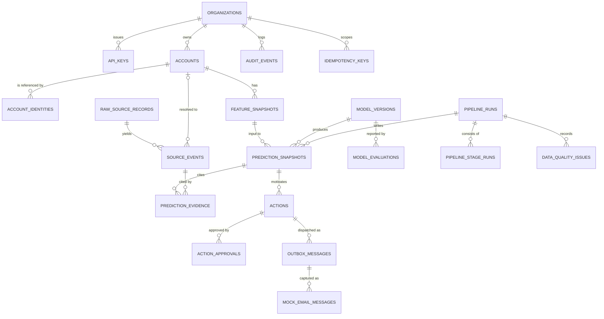

# Database Schema and Tenant Isolation

Target: PostgreSQL 16. All schema changes go through Alembic migrations. The application never runs DDL.

## Entity relationship diagram



Every tenant-owned table carries `org_id`. `MODEL_VERSIONS` and `MODEL_EVALUATIONS` are platform-level and hold no customer data (see ADR-008).

## Tenant isolation strategy

Three layers, each sufficient on its own for its failure mode:

1. **Identity.** `org_id` comes from the authenticated API key or dev token, or from the worker's explicit organisation list (ADR-022). It is never read from a request body, path, or query.
2. **Query design.** Every repository method takes `org_id` explicitly and includes it in the `WHERE` clause and in every join condition.
3. **PostgreSQL RLS (defence in depth).** Every tenant table has `ENABLE ROW LEVEL SECURITY` and `FORCE ROW LEVEL SECURITY`. The session sets `app.current_org_id` with `SET LOCAL` at the start of each transaction.

### RLS policy pattern

```sql
CREATE POLICY tenant_isolation ON accounts
  USING      (org_id = NULLIF(current_setting('app.current_org_id', true), '')::uuid)
  WITH CHECK (org_id = NULLIF(current_setting('app.current_org_id', true), '')::uuid);
```

- If the setting is unset or empty, the predicate evaluates to NULL, so the query returns no rows and writes are rejected. The policy fails closed, not with an error.
- `WITH CHECK` stops a session from inserting or updating a row for another organisation.
- `FORCE` makes the table owner subject to the policy as well.

### Roles

| Role | Attributes | Used by | Privileges |
|---|---|---|---|
| `chi_owner` | Owns schema objects. Not used by the API or the worker. | `migrate` service, operator `cli` commands (`create-org`, `issue-key`) | DDL. Creates tables, policies, functions. Operator commands are run by a human or an admin job, never from a request. |
| `chi_app` | `LOGIN`, `NOSUPERUSER`, `NOBYPASSRLS`, `NOCREATEROLE`, not owner | `api`, the worker | `SELECT`, `INSERT`, `UPDATE` on specific tables. No `DELETE` on evidence tables. No DDL. |
| ~~`chi_scheduler`~~ | Removed from configuration (ADR-022). | Nothing | It never held table grants. An existing local database may still contain the role; see `phase-1-setup-and-changes.md`. |

### Cross-tenant operations by the worker

> **Not implemented, and superseded by ADR-022.** The worker is one sequential process with an explicit list of organisation IDs. It validates them against `organizations` at startup, one organisation at a time under that organisation's tenant context, and sets one organisation per transaction. RLS stays on every tenant table. No claim policies or scheduler role will be built unless concurrent workers are later required. The text below is the original design, kept for history.

Some worker steps must see rows before the tenant is known: the scheduler lists active organisations, and executors claim the next pending run. With fail-closed RLS these would return nothing, so they use narrow claim policies instead of a bypass role:

```sql
-- Scheduler: list active tenants, column-level
CREATE POLICY org_scheduler_list ON organizations FOR SELECT TO chi_scheduler
  USING (status = 'active');
GRANT SELECT (id, status) ON organizations TO chi_scheduler;

-- Executors: claim one pending run; the claim transaction sets app.worker_claim = 'on'
CREATE POLICY run_claim ON pipeline_runs FOR UPDATE TO chi_app
  USING (status = 'pending' AND current_setting('app.worker_claim', true) = 'on')
  WITH CHECK (status = 'running' AND current_setting('app.worker_claim', true) = 'on');

-- Dispatcher: claim due outbox messages across tenants
CREATE POLICY outbox_claim ON outbox_messages FOR UPDATE TO chi_app
  USING (state IN ('pending', 'retry_due') AND next_attempt_at <= now()
         AND current_setting('app.worker_claim', true) = 'on')
  WITH CHECK (state = 'sending' AND current_setting('app.worker_claim', true) = 'on');
```

- After a claim, the executor sets `app.current_org_id` for the claimed row and does all remaining work under tenant context. Claim mode is only enabled inside the claim statement's transaction.
- Limitation: `app.worker_claim` is a session setting, so it guards against accidental cross-tenant access by worker code. It does not stop a compromised worker process. That is stated in `security.md`.
- The API role has no claim policy, so an API request cannot use claim mode.
| `postgres` | Superuser (container default) | Never used by the application | Not referenced in any connection string. |

Verification is a test, not a comment. The isolation suite asserts that `chi_app` has `rolsuper = false`, `rolbypassrls = false`, is not the owner of any tenant table, and that `relrowsecurity` and `relforcerowsecurity` are true on every tenant table.

### API key lookup before tenant context exists

> **Implemented, but not the default for the local demo.** With `AUTH_MODE=dev_tokens` this lookup is not used. It is kept for `AUTH_MODE=api_keys` (ADR-022).

The key must be resolved before `app.current_org_id` is known. Because `api_keys` is under `FORCE ROW LEVEL SECURITY`, a `SECURITY DEFINER` function owned by `chi_owner` would not bypass RLS, so it is not used. Instead the middleware sets a second session setting, `app.api_key_prefix`, and `api_keys` has a second policy that permits one prefix at a time:

```sql
CREATE POLICY api_key_lookup ON api_keys FOR SELECT
  USING (key_prefix = NULLIF(current_setting('app.api_key_prefix', true), ''));
```

- The middleware extracts the prefix from the bearer token, runs `SET LOCAL app.api_key_prefix`, looks up exactly one row, verifies the hash in constant time, then sets `app.current_org_id` for the rest of the request.
- The lookup policy grants `SELECT` on a single prefix only. It cannot enumerate keys or organisations. `chi_app` has no `INSERT`, `UPDATE`, or `DELETE` on `api_keys`; key issuance and revocation run through the `cli` command under an admin path described in ADR-010.
- Key prefixes are not secret. The secret part is never stored or logged.

### Global (non-tenant) tables

| Table | Access by `chi_app` | Reason |
|---|---|---|
| `organizations` | No direct access. Name shown only via the authenticated org's own row, through a view with RLS on `id`. | Prevents enumerating tenants. |
| `model_versions`, `model_evaluations` | `SELECT` only | Platform artefacts, written by the offline training CLI under `chi_owner`. |

## Table definitions

Column types are summarised. The full data dictionary, with descriptions and examples, goes in `data-dictionary.md` at Phase 1.

### Tenancy and access

| Table | Key columns | Constraints and notes |
|---|---|---|
| `organizations` | `id uuid PK`, `slug text unique`, `display_name`, `created_at` | Demo orgs: `acme-saas`, `northwind-cloud`, `globex-data`. |
| `api_keys` | `id uuid PK`, `org_id FK`, `key_prefix text unique`, `key_hash text`, `role text` (`csm`, `admin`, `readonly`), `created_at`, `revoked_at`, `last_used_at` | Only the hash is stored (Argon2id or HMAC-SHA256 with a server pepper, see ADR-010). Plaintext shown once at issuance. |
| `audit_events` | `id bigserial PK`, `org_id FK`, `actor_key_id`, `event_type`, `entity_type`, `entity_id`, `detail jsonb`, `created_at` | Append-only. `chi_app` has `INSERT` and `SELECT`. A trigger rejects `UPDATE` and `DELETE` for every role. |
| `idempotency_keys` | `id PK`, `org_id FK`, `key text`, `request_hash text`, `response_status int`, `response_body jsonb`, `created_at`, `expires_at` | `UNIQUE (org_id, key)`. Expired rows are purged by the worker. |

### Accounts and identity (migration 0003, implemented)

| Table | Key columns | Constraints and notes |
|---|---|---|
| `accounts` | `id uuid PK`, `org_id FK`, `canonical_name`, `primary_domain`, `segment`, `plan_tier`, `region`, `timezone` (default `UTC`), `created_at` | `UNIQUE (org_id, id)` for composite FKs. `UNIQUE (org_id, primary_domain)`. `timezone` is used to interpret product timestamps that arrive without an offset. |
| `account_identities` | `id PK`, `org_id`, `account_id`, `source` (`salesforce`, `gmail`, `zendesk`, `product`, `stripe`), `source_account_key text`, `match_method` (`exact_id`, `domain`, `fuzzy_name`, `manual`), `match_confidence numeric(4,3)`, `created_at` | `UNIQUE (org_id, source, source_account_key)`. Composite FK `(org_id, account_id)` to `accounts`. Holds the known source keys from the account master. Ambiguous matches are not written here; they are recorded on the event and in `data_quality_issues`. |

### Raw landing and normalised events (migration 0003, implemented)

| Table | Key columns | Constraints and notes |
|---|---|---|
| `raw_source_records` | `id PK`, `org_id`, `source`, `source_record_id text`, `payload jsonb`, `payload_sha256 char(64)`, `received_at timestamptz`, `ingest_batch_id uuid` | `UNIQUE (org_id, source, source_record_id, payload_sha256)`; re-delivery of identical content is a no-op. Changed content with the same source ID is a new row. There is no `is_revision` column: a revision is a second row with the same `source_record_id`, recorded in `data_quality_issues` as `revised_record`. `received_at` of a duplicate delivery is collapsed to its earliest delivery before landing. |
| `source_events` | `id PK`, `org_id`, `account_id NULL`, `source`, `event_type`, `source_record_id`, `dedupe_key`, `event_time` (business time, UTC), `ingested_at` (platform time, UTC), `identity_status` (`matched`, `unmatched`, `ambiguous`), `attributes jsonb`, `raw_record_id` | `UNIQUE (org_id, source, dedupe_key)` where `dedupe_key = source_record_id:sha256[:12]`, so a revision is a separate, later event. Composite FKs to `accounts` and `raw_source_records`. `CHECK ((identity_status = 'matched') = (account_id IS NOT NULL))`. Indexes `(org_id, account_id, event_time)` and `(org_id, ingested_at)`. |
| `data_quality_issues` | `id PK`, `org_id`, `run_id uuid NULL` (not yet a foreign key; `pipeline_runs` does not exist until Phase 5), `kind`, `source`, `ref`, `detected_at`, `detail jsonb` | `kind` is one of `duplicate`, `late_arrival`, `out_of_order`, `unmatched_identity`, `ambiguous_identity`, `missing_source`, `revised_record`, `timezone_assumed`, `malformed_record`. `UNIQUE (org_id, kind, source, ref)` makes re-detection idempotent. Counts are computed from this table, not stored as totals. |

Rules enforced by the migration and tests:

- All five tables have `ENABLE` and `FORCE ROW LEVEL SECURITY` with the same fail-closed `tenant_isolation` policy as the earlier tables. Existing policies were not changed.
- `chi_app` has `SELECT` and `INSERT` only on these tables. There is no `UPDATE` or `DELETE`. An event whose identity could not be resolved stays `unmatched` or `ambiguous`; it is never patched afterwards. Resolving it later would need a new, reviewed mechanism (Phase 5 or later).
- Visibility for features and scoring is `event_time <= cutoff AND ingested_at <= cutoff`.
- Late arrival is recorded when `ingested_at - event_time` exceeds 3 days. Out-of-order is recorded per delivery batch whose rows are not in `received_at` order. `missing_source` is defined but not yet written by ingestion; coverage gaps are measured in Phase 3 as features.

### Features and predictions

| Table | Key columns | Constraints and notes |
|---|---|---|
| `feature_snapshots` | `id PK`, `org_id`, `account_id FK`, `cutoff_at timestamptz`, `feature_set_version text`, `values jsonb`, `created_at` | `UNIQUE (org_id, account_id, cutoff_at, feature_set_version)`. Values are stored per snapshot so a prediction can be reproduced without recomputing history. |
| `model_versions` | `id PK`, `version text unique` (e.g. `churn-lr-2026.10.29-1`), `algorithm`, `feature_set_version`, `training_cutoff_at`, `trained_at`, `artifact_path`, `artifact_sha256`, `selection_rule text`, `status` (`candidate`, `registered`, `retired`) | No RLS. `chi_app` reads only. Only one `registered` version is active at a time (partial unique index). |
| `model_evaluations` | `id PK`, `model_version_id FK`, `split` (`train_cv`, `validation`, `temporal_test`, `baseline_rules`), `metrics jsonb`, `slices jsonb`, `created_at` | Metrics persisted by `ml/evaluate.py`. The dashboard and API read from here. Nothing is hardcoded. |
| `pipeline_runs` | `id PK`, `org_id`, `status` (`pending`, `running`, `succeeded`, `failed`, `dead_letter`), `cutoff_at`, `not_before timestamptz NULL`, `claimed_by text`, `claimed_at`, `attempts int`, `started_at`, `finished_at`, `last_error text` | Claim with `SELECT ... FOR UPDATE SKIP LOCKED`. `UNIQUE (org_id, cutoff_at)` makes scheduling idempotent. Partial unique index on `(org_id) WHERE status = 'running'` allows one running run per organisation. |
| `pipeline_stage_runs` | `id PK`, `run_id FK`, `org_id`, `stage` (`ingest`, `normalise`, `features`, `score`, `policy`, `enqueue_actions`, `dispatch`), `status`, `attempts int`, `started_at`, `finished_at`, `error text` | `UNIQUE (run_id, stage)`. |
| `prediction_snapshots` | `id PK`, `org_id`, `account_id FK`, `run_id FK`, `model_version_id FK`, `feature_snapshot_id FK`, `risk_score numeric(6,5)`, `risk_band` (`low`, `medium`, `high`), `contributions jsonb`, `cutoff_at`, `scored_at timestamptz` | **Append-only.** Index `(org_id, account_id, scored_at DESC)`. Latest per account is a query, not an update. `UNIQUE (org_id, account_id, model_version_id, cutoff_at)` makes re-scoring the same cutoff idempotent. |
| `prediction_evidence` | `prediction_id FK`, `source_event_id FK`, `org_id`, `role` (`supporting`, `recent`) | `PK (prediction_id, source_event_id)`. Join table that makes "which events fed this score" a direct query. |

`contributions` stores per-feature contribution values, the feature value, and the reference value used. The explanation endpoint reads this column. It does not compute text.

### Actions and outreach

| Table | Key columns | Constraints and notes |
|---|---|---|
| `actions` | `id PK`, `org_id`, `account_id FK`, `prediction_id FK`, `action_type` (`executive_check_in`, `renewal_review`, `support_follow_up`), `scoring_window text` (e.g. `2026-W44`), `status` (`proposed`, `suppressed`, `approved`, `rejected`, `expired`), `suppression_reason text NULL`, `created_at`, `status_changed_at` | `UNIQUE (org_id, account_id, action_type, scoring_window)`. Only `status` and `status_changed_at` can change. Every change writes an `audit_events` row. |
| `action_approvals` | `id PK`, `org_id`, `action_id FK`, `approved_by_key_id FK`, `idempotency_key text`, `request_hash text`, `created_at` | `UNIQUE (org_id, action_id)`. A second approval attempt returns the first result. |
| `suppression_rules` | `id PK`, `org_id`, `rule_type` (`recent_contact`, `legal_hold`, `open_escalation`, `do_not_contact`), `params jsonb`, `active bool`, `created_at` | Evaluated by `agent/policies.py`. |
| `outbox_messages` | `id PK`, `org_id`, `action_id FK`, `channel` (`email`), `recipient_ref text` (salted hash), `template_id`, `payload jsonb`, `state` (`pending`, `sending`, `sent`, `retry_due`, `failed`, `dead_letter`, `dry_run`), `attempts int`, `max_attempts int`, `next_attempt_at timestamptz`, `last_error text`, `dedupe_key text`, `created_at`, `sent_at` | `UNIQUE (org_id, dedupe_key)`. Partial index `(state, next_attempt_at)` where state is pending or retry_due. |
| `mock_email_messages` | `id PK`, `org_id`, `outbox_message_id FK`, `to_address text`, `subject`, `body text`, `captured_at` | The mock adapter's only sink. `to_address` is a synthetic address. Real addresses are never stored because the input data is synthetic. |

### Outbox state machine

```
pending --claim--> sending --ok--> sent
                       |
                       +--transient error--> retry_due --claim--> sending
                       |                        (attempts < max)
                       +--attempts >= max--> dead_letter
pending --policy re-check fails--> failed
pending --dry-run mode--> dry_run (terminal, no adapter call)
```

Transitions are only performed by `agent/actions.py` and the dispatcher. Each transition writes an `audit_events` row in the same transaction.

## Indexes that carry the design

| Index | Serves |
|---|---|
| `source_events (org_id, account_id, event_time)` | Feature windows per account as of cutoff |
| `source_events (org_id, dedupe_key)` unique | Idempotent ingestion |
| `prediction_snapshots (org_id, account_id, scored_at DESC)` | Latest prediction and history |
| `prediction_snapshots (org_id, model_version_id, scored_at)` | Ranked list for one model version |
| `outbox_messages (state, next_attempt_at) WHERE state IN ('pending','retry_due')` | Dispatcher claim |
| `pipeline_runs (status, cutoff_at) WHERE status IN ('pending','running')` | Run claim |
| `model_versions (status) WHERE status = 'registered'` unique | One active model |

RLS predicates use `org_id`, so each tenant-scoped index starts with `org_id` where the query shape allows it.

## Data retention and privacy in the schema

- `raw_source_records.payload` holds synthetic metadata only. For real deployments, Gmail and Zendesk payloads would store headers and counts, not bodies. This is recorded in ADR-011.
- Recipient addresses in `outbox_messages` are stored as salted hashes. The mock adapter needs readable addresses for demonstration, so it stores synthetic ones in `mock_email_messages` only.
- No table stores plaintext API keys.

## Migration plan

| Migration | Contents |
|---|---|
| `0001_roles_and_extensions` | `chi_owner` and `chi_app` roles, `pgcrypto` for `gen_random_uuid()` if needed |
| `0002_tenancy_and_auth` | `organizations`, `api_keys`, `auth_lookup_api_key`, `audit_events` with immutability trigger, `idempotency_keys` |
| `0003_accounts_and_ingestion` | `accounts`, `account_identities`, `raw_source_records`, `source_events`, `data_quality_issues`, RLS on all |
| `0004_features_and_models` | `feature_snapshots`, `model_versions`, `model_evaluations` |
| `0005_runs_and_predictions` | `pipeline_runs`, `pipeline_stage_runs`, `prediction_snapshots`, `prediction_evidence`, RLS |
| `0006_actions_and_outbox` | `actions`, `action_approvals`, `suppression_rules`, `outbox_messages`, `mock_email_messages`, RLS, grants |

Each migration has a tested downgrade for local development. Production downgrade policy is out of scope and noted in the security document.
